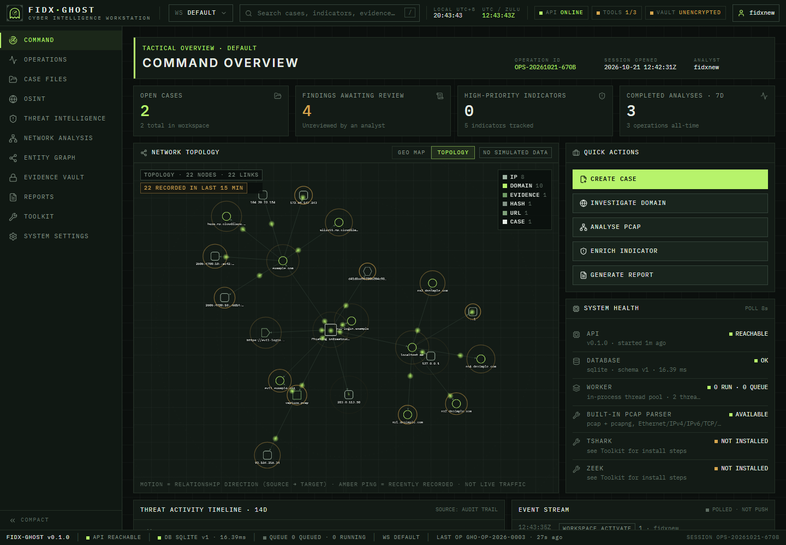
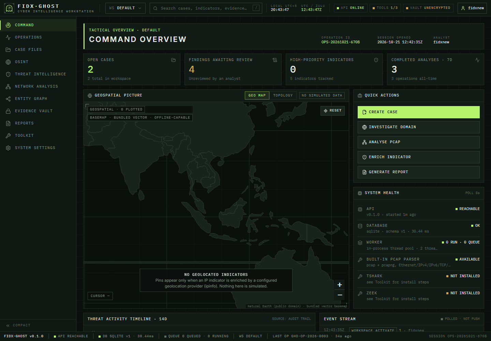
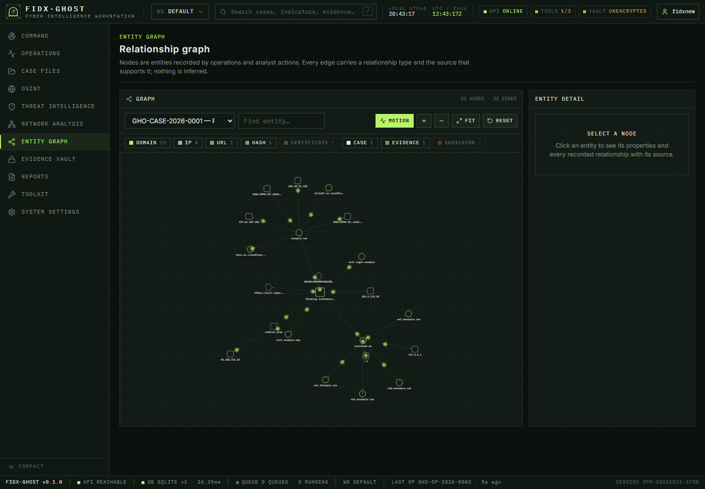
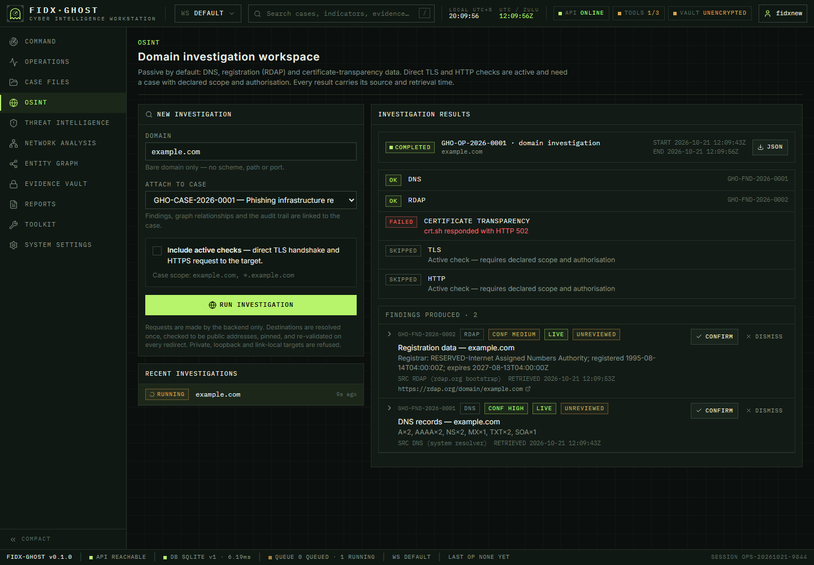
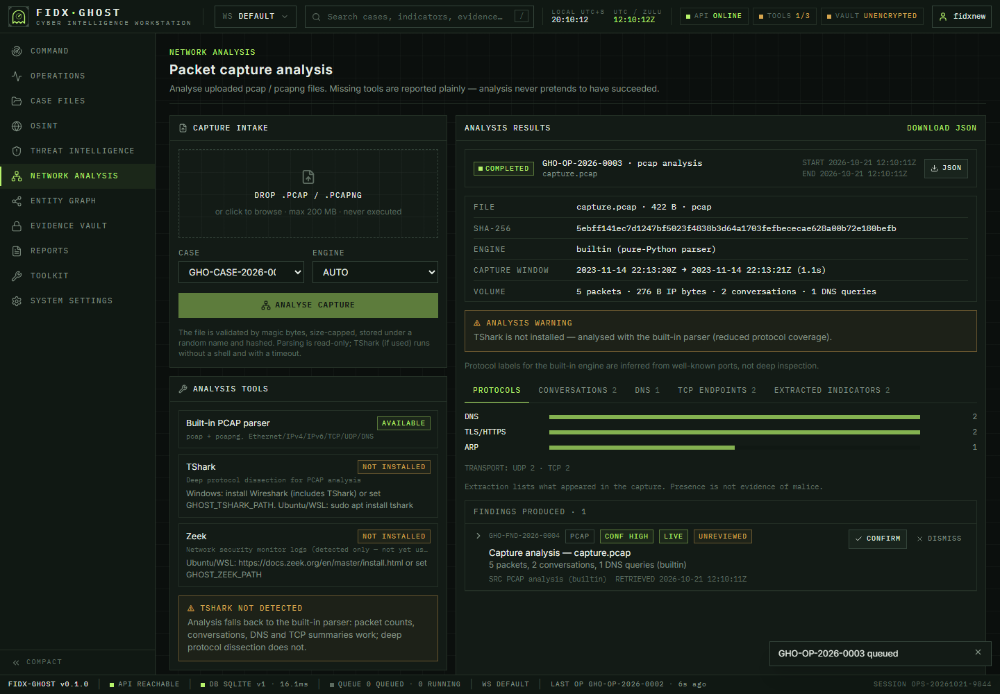
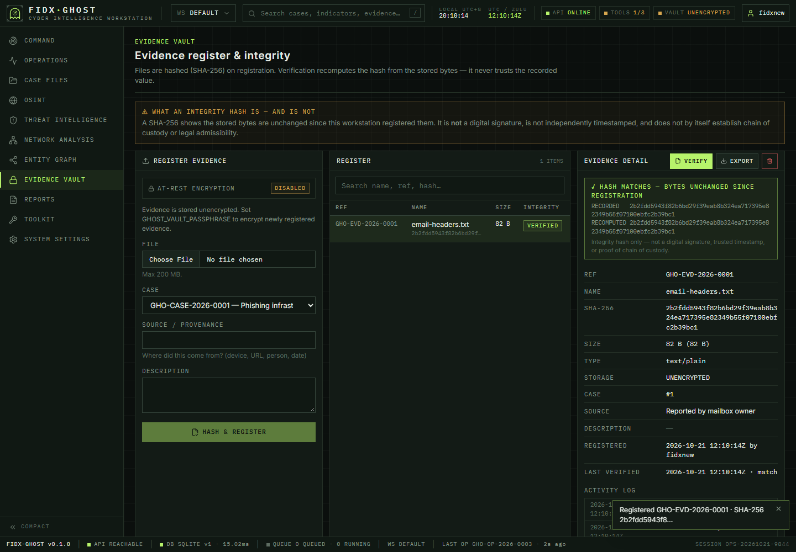

# FIDX-GHOST — Cyber Intelligence Workstation

A local-first, single-analyst cyber-intelligence workstation: case management, passive OSINT
domain investigation, IOC enrichment, PCAP analysis, entity graph, evidence vault with integrity
hashing, HTML reporting, a `ghost` CLI, and an optional AI analyst — wrapped in a tactical
operations-room interface.

It is an **independent, lawful OSINT / defensive-security tool**. It is not affiliated with, and
does not imitate, any government or military body. It is a privacy-*conscious* workstation, not an
anonymity or evasion tool.





<table>
<tr>
<td></td>
<td></td>
</tr>
<tr>
<td></td>
<td></td>
</tr>
</table>

<sub>Screenshots are real captures of the running app (data created through the app itself; DNS/RDAP results are live).</sub>

> **Honesty rule:** every status light, metric and map pin is derived from real state. Nothing is
> simulated. When a tool, provider or network is unavailable the UI says so and offers setup steps.

---

## 1. Quick start

Requirements: **Python 3.10+**, **Node 20+** (only to build/develop the UI).

```powershell
# Windows (PowerShell), from the project root
python -m pip install -r backend\requirements.txt     # flask, httpx, cryptography, click
cd frontend; npm install; npm run build; cd ..          # builds the UI into frontend\dist
copy .env.example .env                                  # optional — everything is optional
.\ghost.cmd serve                                       # API + UI on http://127.0.0.1:8787
```

Open <http://127.0.0.1:8787>. Data lives in `./data` (SQLite DB, vault, uploads, reports, backups).

**Development with hot reload** — two terminals:

```powershell
.\ghost.cmd serve                    # backend on :8787
cd frontend; npm run dev             # Vite on :5173, proxies /api to :8787
```

### Windows + VS Code + Ubuntu (WSL2)

Recommended: develop in WSL2 so TShark/Zeek are one `apt` away.

```bash
# in the Ubuntu shell
sudo apt update && sudo apt install -y python3 python3-pip nodejs npm tshark
code .                                  # VS Code "WSL" extension opens the folder in WSL
python3 -m pip install -r backend/requirements.txt
(cd frontend && npm install && npm run build)
./ghost serve                           # then browse to http://localhost:8787 from Windows
```

Notes: keep the project on the WSL filesystem (`~/`) rather than `/mnt/c` or OneDrive — it is much
faster and avoids file-lock issues. Port 8787 is forwarded to Windows automatically. In WSL, the
DNS resolver is read from `/etc/resolv.conf`; override with `GHOST_DNS_SERVER` if needed.
For TShark on Windows install Wireshark and set `GHOST_TSHARK_PATH`.

Optional editable install (puts a real `ghost` command on PATH):
`python -m pip install -e backend`.

---

## 2. Architecture

```
frontend/  React 19 + TypeScript + Vite + Tailwind 4  — Leaflet (bundled vector map), Cytoscape graph + motion overlay, Inter + IBM Plex Mono (bundled)
backend/ghost/
  api/main.py        Flask routes — thin; validation + JSON only
  services/          all business logic (cases, operations, osint, intel, pcap, evidence,
                     reports, ai, findings/graph, command, system)
  netguard.py        SSRF / DNS-rebinding / redirect protection for every outbound request
  dnsclient.py, dnswire.py   minimal DNS stub client + wire parser (bounds-checked)
  db.py              SQLite, versioned migrations (PRAGMA user_version), portable SQL
  cli.py             `ghost` (click) — calls the same services as the API
backend/tests/       73 unittest cases        frontend/src/*.test.*   18 vitest cases
e2e/                24-step real-browser journey (headless Chromium over DevTools protocol)
```

* One short-lived SQLite connection per unit of work (WAL). Schema SQL avoids SQLite-only features
  to keep a PostgreSQL migration feasible.
* Operations (`domain_investigation`, `ioc_enrichment`, `pcap_analysis`) run in an in-process
  thread pool with a real lifecycle: `draft → queued → running → completed | failed | cancelled`.
  Operations left running when the process dies are marked **failed (interrupted)** at next start.
* Everything the UI shows comes from `/api/*`. API keys never leave the backend.

---

## 3. Features (what is implemented)

| Area | Implemented |
|---|---|
| **Shell** | 11-section nav rail (compact mode), command bar with workspace selector, working global search (cases / indicators / evidence, `/` to focus), local + UTC clocks, status chips (API, tools, vault, link/field mode), analyst menu, bottom status strip (version, API, DB + latency, queue, workspace, last successful operation). Status is polled every 8 s; **API never shows green unless the last poll succeeded**. |
| **Command Centre** | Generated operation/session ID; 4 metrics; **Geo map** (Leaflet on a bundled Natural Earth vector basemap — no tiles, no third-party requests, works offline; pulsing pins only for provider-geolocated indicators) and an **animated Topology view** (real entities/relationships: markers travel along each link in its recorded direction, amber rings ping entities recorded in the last 15 min — structure and recency, *not* live traffic); 14-day activity timeline from the audit trail; event stream (polled, real timestamps); system health; recent investigations/operations; 5 quick actions, each opens a real form or page. |
| **Cases** | Create / view / edit / archive / search; backend-issued IDs (`GHO-CASE-2026-0001`); objective, scope, **authorisation declaration**, priority, tags, notes, per-case timeline, findings with review workflow (confirm / dismiss), linked indicators/evidence/operations/reports. Workspaces scope cases. |
| **OSINT** | DNS (A/AAAA/NS/MX/TXT/CNAME/SOA/CAA via own resolver client), RDAP registration, certificate transparency (crt.sh). **Active** TLS-certificate inspection and HTTPS metadata only for a case with declared scope + authorisation + a stated authoriser. Every finding stores source, URL, retrieval time, confidence, freshness (`live` → `stale` after 24 h). Failed steps are reported, never filled in. |
| **Threat intel** | Normalisation (accepts defanged `hxxp`, `[.]`), type detection, duplicate detection, VirusTotal / AbuseIPDB / ipinfo providers (keys via env), per-provider status, explainable severity + confidence with reasoning, case linking, CSV/JSON export. Private IPs are never sent to third parties. |
| **Network** | Upload pcap/pcapng (magic-byte check, size cap, SHA-256, random storage name, never executed). Built-in parser: time range, protocol distribution (port-based labels), conversations, DNS queries + answers, TCP endpoints (SYN counts), extracted domains/IPs, warnings; TShark engine when installed. Downloadable JSON. |
| **Entity graph** | Domains, IPs, URLs, hashes, certificates, cases, evidence. Edges are created only by real operations/analyst actions and carry `rel_type`, `source`, and the finding reference. Cytoscape.js; filter by type/case, search/highlight, zoom, pan, drag, fit, reset, detail panel with every relationship's source. |
| **Evidence vault** | Register with SHA-256, optional AES-256-GCM encryption at rest, **verification recomputes the hash from stored bytes**, custody activity log, export, delete (audit record keeps name + hash), ZIP backup with SHA-256 manifest. UI states clearly that this is an integrity hash, not a signature or chain-of-custody proof. |
| **Reports** | Self-contained HTML: scope, methodology, findings, indicators, evidence, notes, limitations, rule-derived recommendations, audit appendix. Everything HTML-escaped; served with a restrictive CSP. PDF via the browser's *Print → Save as PDF*. |
| **Field Mode** | Persisted toggle; while on, the backend **refuses every outbound operation** (lookups, enrichment). Local work continues. Online/offline indicator from `navigator.onLine`. |
| **AI analyst** | Optional, any OpenAI-compatible endpoint (e.g. local Ollama) configured **only via env**. Sees a bounded snapshot of one case; output is always labelled *MODEL-GENERATED — NOT VERIFIED*, never written into findings. Setup screen when unconfigured. |
| **CLI** | See §5. |

---

## 4. Security model

* **Outbound requests** (`netguard.py`): hostname resolved once; *every* address must be globally
  routable (loopback, RFC 1918, link-local/metadata, CGNAT, multicast, v4-mapped v6 all rejected);
  the request goes to the validated IP with `Host`/SNI preserved (anti-rebinding); redirects are
  never auto-followed — each hop is re-parsed, re-resolved and re-validated; scheme (http/https),
  port (80/443/8080/8443) and credential-in-URL allow-lists; streamed bodies with a hard byte cap.
  Verified live: `localtest.me` (resolves to 127.0.0.1) is refused for TLS/HTTP.
* **Authorisation:** active checks need a case with scope + authorisation acknowledgement and an
  authoriser statement; all recorded in the audit trail. Passive by default.
* **Local API:** binds to 127.0.0.1; rejects unexpected `Host` headers (DNS rebinding) and
  cross-origin state-changing requests (CSRF); `nosniff`; evidence is only ever served as
  `application/octet-stream` attachment.
* **Uploads:** magic-byte validation, size limit, random names, never executed, TShark run with an
  argument list (no shell) and timeout. Evidence names are stripped of path components.
* **Secrets:** env only; never in responses, logs, audit detail or source URLs (the ipinfo token is
  excluded from stored URLs). Tests assert this.
* **No** exploitation, credential theft, persistence, scanning of IP ranges, or arbitrary command
  execution exists in the codebase.

---

## 5. `ghost` CLI

`ghost.cmd` (Windows) / `./ghost` (Linux, WSL) — or `ghost` after `pip install -e backend`.
Exit codes: **0** ok · **1** error · **2** usage · **3** unavailable (tool/provider/mode) · **4** operation failed / integrity mismatch.
Most commands take `--json`. `--debug` enables logging (never prints secrets).

```
ghost status [--json] [--api]                         real DB / worker / tool / provider / vault state
ghost serve [--host H] [--port P]                     run API + UI
ghost case list|show|create                           create "Name" --scope X --authorised --priority high --tag t
ghost osint domain example.com [--case N] [--active --authorisation "ticket #"]
ghost intel add|enrich|list|export                    enrich <value> [--case N]; export --format csv --output f
ghost network analyze capture.pcap [--case N] [--engine auto|builtin|tshark] [--output out.json]
ghost evidence add|verify|list                        verify N exits 4 on mismatch
ghost report generate N [--output report.html]
```

---

## 6. Testing

```powershell
cd backend;  $env:PYTHONPATH="."; python -m unittest discover -s tests     # 73 tests
cd frontend; npx tsc --noEmit; npx vitest run; npm run build               # types, 18 tests, build
```

Real-browser end-to-end journey (needs a Chromium-based browser, a built UI, and internet for the
OSINT step). It starts a throw-away server + data dir, then clicks through every feature:

```bash
(cd frontend && npm run build)
./e2e/run.sh            # Linux / WSL / Git Bash;  BROWSER=/path/to/chrome if auto-detect fails
```

CI (`.github/workflows/ci.yml`) runs the backend tests and the frontend type-check, tests and build.

Covered: SSRF/rebinding/redirect guards, case persistence across restart, authorisation gates,
operation lifecycle and failure honesty, IOC normalisation / dedupe / scoring / mocked enrichment,
pcap + pcapng parsing, upload rejection, hash tamper detection, encryption round-trip, backups,
report escaping, API guards (Host, Origin), secrets never serialised, CLI exit codes, UI honesty
(API chip never green when backend is down), empty states, case-form authorisation validation.
The browser journey additionally covers: case create/edit/notes, live DNS+RDAP investigation, SSRF refusal
of a loopback-resolving host, IOC normalisation + duplicate detection, PCAP upload → results, evidence
register/verify/**tamper detection**/export/delete, graph filters + search, report generation + CSP,
Field Mode enforcement, backup download, global search navigation, workspaces, the bundled vector map
(no raster tiles), a topology overlay that is verifiably animating, and **zero third-party network requests**.

---

## 7. Known limitations (read these)

* **Backend stack substitutions.** Development began on a machine with almost no usable internet,
  so the backend uses what was already installed: **Flask** (instead of FastAPI), **click**
  (instead of Typer), a **built-in DNS client** (instead of dnspython) and **`unittest`** (instead
  of pytest). The service layer is framework-independent, so moving the thin `api/main.py` to
  FastAPI is a mechanical change.
* **Not verified end-to-end here:** the **TShark engine** (not installed; code path covered only by
  design), **VirusTotal / AbuseIPDB / ipinfo** (no keys — covered with mocked responses),
  **AI endpoint** (mocked), **TLS/HTTP active steps** against a real authorised target (parsing and
  guards are tested; no authorised live target was used). DNS and RDAP were exercised live.
  crt.sh returned HTTP 502 during testing and is reported as a failed step.
* **Zeek** is detected only; it is not used for analysis.
* Built-in PCAP protocol labels come from well-known ports, not deep inspection; no TCP
  reassembly, TLS/HTTP dissection or IPv4 fragment reassembly. Cap: 3 M packets.
* **No** authentication / multi-user, cloud sync, sync queue, session lock screen or automatic
  retention policy. The SQLite file is **not encrypted** (use BitLocker/LUKS); only evidence files
  are (when `GHOST_VAULT_PASSPHRASE` is set, and only for evidence registered after it is set).
* Integrity hashes are not digital signatures or trusted timestamps; nothing claims admissibility.
* Reports are HTML; PDF relies on the browser. Report recommendations are rule-derived, not AI.
* The default basemap is a bundled 1:110m Natural Earth vector map (country level, no street detail).
  For street-level detail set `GHOST_MAP_TILE_URL` to a raster provider you are licensed to use
  (OpenStreetMap's public tile servers block clients that don't follow their usage policy).
* Telemetry-style claims are deliberately absent: the event stream is *polled*, not pushed.
* Flask's built-in server is used (single-user, loopback). Don't expose it to a network.
* Responsive layout was checked at 500 px, 820 px and 1440 px (Edge headless cannot go below
  ~500 px); keyboard navigation and ARIA roles are implemented but no full WCAG audit was done.
* The graph is laid out with Cytoscape's force-directed `cose`; very large graphs (>1 k nodes) will be slow.
* The browser journey was run on Windows + Edge only (Linux/Chrome path detection is untested).

## 8. Recommended next task

1. Install TShark and run the PCAP workflow against a real capture; compare against the built-in
   engine and add Zeek log ingestion.
2. Add real provider keys and a local Ollama model; exercise enrichment and AI analyst end-to-end.
3. Run an **authorised** active investigation to validate TLS/HTTP steps against a live target.
4. Consider FastAPI/Typer + pytest migration if you prefer that stack (service layer is unchanged).
5. Optional: session lock + DB-at-rest encryption (SQLCipher) for true Field Mode.

## License

MIT — see [LICENSE](LICENSE). Use only for lawful, authorised security work.
